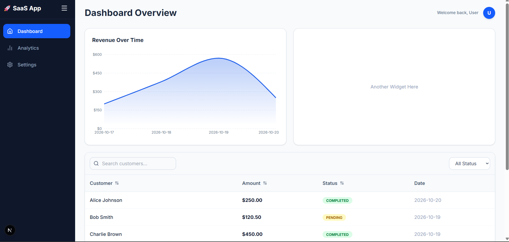

# 📊 SaaS Analytics Dashboard

A modern, fully responsive SaaS dashboard built with **Next.js**, **TypeScript**, **Recharts**, and **Tailwind CSS**. Features a collapsible sidebar, dynamic data visualization, and complex state management using advanced React patterns.

🔗 **Live Demo:**

    <h2>📸 Project Screenshot</h2>

    

    Live : <https://next-dashboard-five-eta-76.vercel.app>

## ✨ Features

- **Dashboard Overview:** A live revenue chart and a fully sortable, filterable data table of recent sales.
- **Interactive Analytics:** Time-range selectors (`1M`, `3M`, `6M`, `1Y`) that dynamically update both the KPI stat cards and the traffic bar chart.
- **User Settings:** A fully functional settings page with tabbed navigation (Profile, Notifications, Security) and custom toggle switches.
- **Global Sidebar:** A collapsible sidebar using React Context and a custom `useSidebar` hook, preserving navigation state without reloading the page.
- **Fully Typed:** Strict TypeScript interfaces for sales data, chart data, and reducer actions.

## 🛠️ Tech Stack

- **Framework:** Next.js (App Router)
- **Language:** TypeScript
- **Styling:** Tailwind CSS
- **Charts:** Recharts
- **Icons:** Lucide-React

## 🧠 Architecture Highlights (Advanced React)

**1. `useReducer` for Complex State**
The Sales Table doesn't use multiple `useState` hooks. Instead, it uses a single `useReducer` to handle search queries, status filtering, and column sorting in one predictable state machine.

**2. `useMemo` for Performance**
The Sales Table filters and sorts a list of data on every keystroke. `useMemo` ensures that this expensive calculation only re-runs when the table's state or the initial data actually changes.

**3. Next.js App Router & Server Components**
The main layout and static pages are rendered on the server for maximum speed. Interactive components (like the Sidebar and Charts) use the `"use client"` directive only where necessary, keeping the JavaScript bundle small.

**4. Reusable Component Architecture**
Stat cards, sidebar links, and settings toggles are all built as reusable components, passing props dynamically to keep the codebase DRY (Don't Repeat Yourself).
